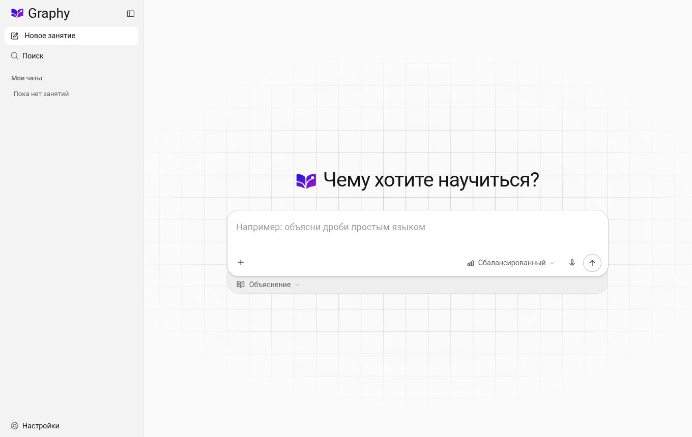
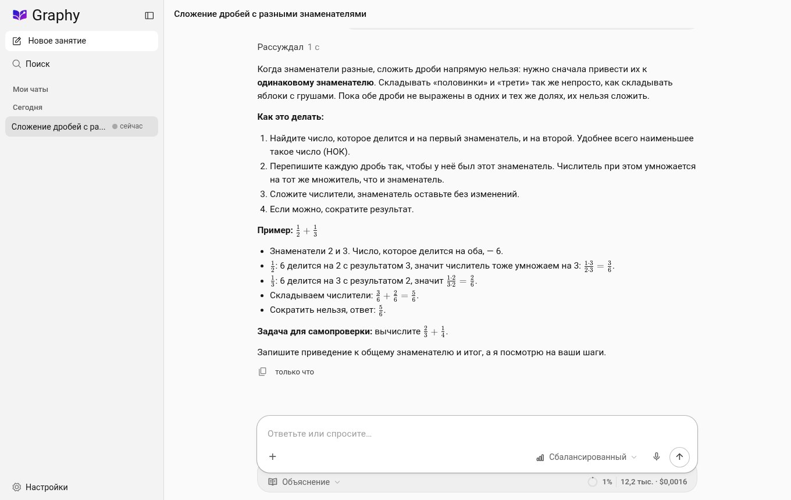
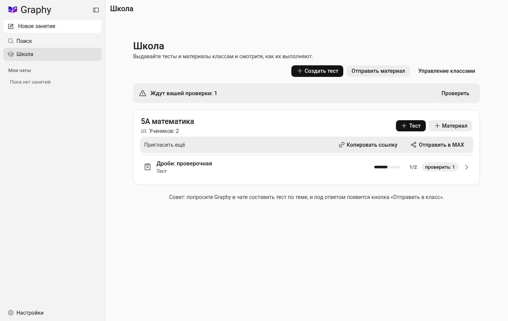
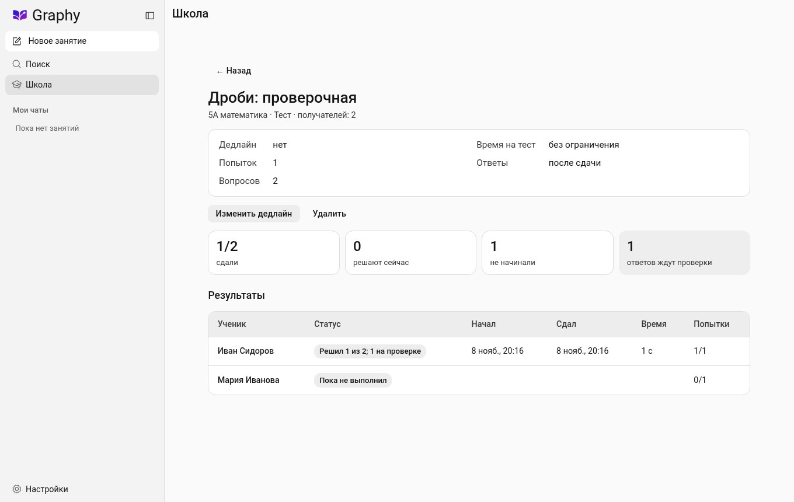
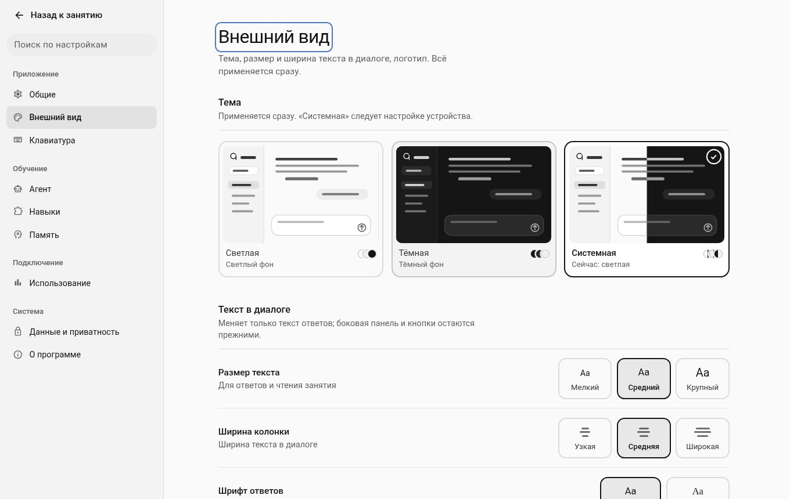
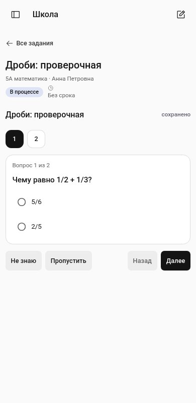
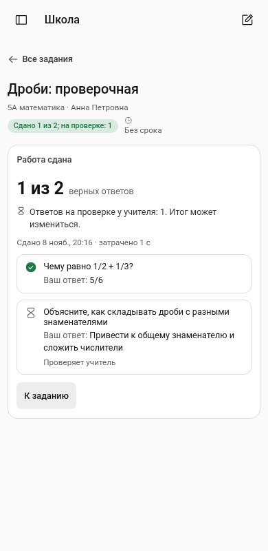
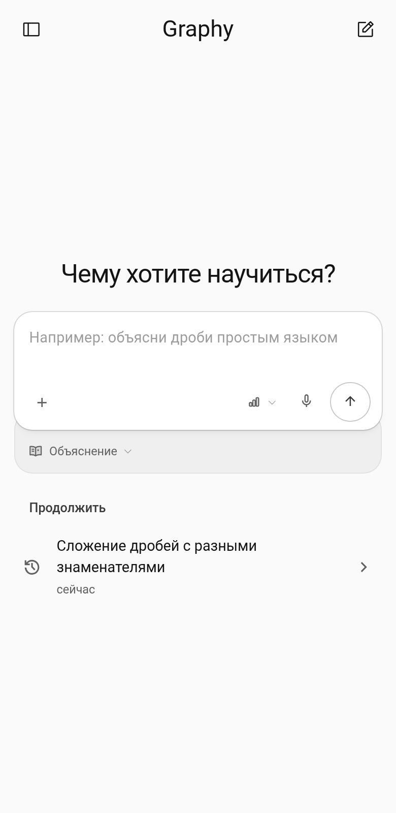

<div align="center">

# Graphy

**ИИ-репетитор, который учит, а не просто отвечает.**
Объяснения, квизы, учебные материалы и «Школа» для учителя и класса. Работает в браузере и как мини-приложение в MAX.



</div>

**Бот в MAX:** <https://max.ru/ideya_fiks_2_bot>

## Возможности

- **Чат-репетитор.** Объясняет с формулами и примерами, задаёт проверочные вопросы, ведёт план занятия и помнит, что у ученика не получалось.
- **Режимы занятия:** «Объяснение», «Квиз» (вопросы без подсказок, разбор после отчёта, необязательный таймер) и «Материалы» (конспекты, раздатки и презентации файлами: PDF, DOCX, PPTX, XLSX).
- **Инструменты агента:** веб-поиск и чтение страниц, исследователь-субагент, песочница с Python, LaTeX, OCR, pandoc; загрузка файлов, фото и голосовой ввод.
- **Школа (MAX).** Роли «Ученик» и «Учитель»: учитель создаёт классы, выдаёт тесты и материалы, видит результаты и проверяет свободные ответы; ученик проходит тест с таймером и сохранением черновика.
- **Работает без настройки.** Модели подключены через сервис Graphy (запрос идёт на наш сервер, затем в OpenRouter с ключом сервера); пользователь выбирает только качество ответа: «Быстрый», «Сбалансированный», «Глубокий». Ключ сервера нигде не виден.

<table>
  <tr>
    <td></td>
    <td></td>
  </tr>
  <tr>
    <td align="center">Занятие с формулами</td>
    <td align="center">Школа: класс, тесты, проверка</td>
  </tr>
  <tr>
    <td></td>
    <td></td>
  </tr>
  <tr>
    <td align="center">Результаты и ручная проверка</td>
    <td align="center">Настройки</td>
  </tr>
</table>

<p align="center">
  
  
  
</p>

## Быстрый старт (Docker)

Нужен Docker 24+ и 4 ГБ свободного места. Образ содержит всё: сайт, агента, Python-библиотеки, LaTeX, OCR.

**1. Получить образ** (один из вариантов)

```bash
# собрать из исходников (Rust-ядро собирается в контейнере rust:bookworm)
./scripts/docker-build.sh                      # → graphy:latest
# или: docker build -t graphy:latest .         # дольше, всё внутри Docker

# или загрузить готовый образ: graphy-image.tar.gz из раздела Releases
# https://github.com/Augenq/Graphy-Ai/releases/latest  (sha256: c24dde1824404a4231432804d673cecb973ef2e241bdac611ce1cb5a9389db29)
docker load < graphy-image.tar.gz              # → graphy:latest
```

**2. Запустить**

```bash
docker run -d --name graphy --restart unless-stopped \
  -p 127.0.0.1:5174:5174 \
  -v graphy-data:/data -v graphy-workspace:/workspace \
  graphy:latest
```

Откройте <http://localhost:5174>: ключ не нужен. Запросы к модели идут через сервис Graphy (https://78-17-61-24.sslip.io:8443), у него суточные лимиты на установку, IP и общий расход; контейнеру нужен доступ в интернет. Данные хранятся в томах `graphy-data` и `graphy-workspace`.

Свой провайдер без сервиса Graphy: `-e GRAPHY_SERVICE_URL=off -e OPENROUTER_API_KEY=sk-or-...` (и другие ключи, см. [backend/PROVIDERS.md](backend/PROVIDERS.md)).

Ту же конфигурацию с поиском SearXNG поднимает `docker compose up -d`.

**3. Проверить из командной строки**

```bash
curl -s http://localhost:5174/api/v1/health
# {"ok":true,"protocol":1,"version":"0.3.0","engine":"rust"}

SID=$(curl -s -X POST http://localhost:5174/api/v1/sessions -H 'content-type: application/json' -d '{}' \
      | python3 -c 'import sys,json; print(json.load(sys.stdin)["id"])')
curl -s -X POST http://localhost:5174/api/v1/sessions/$SID/messages -H 'content-type: application/json' \
     -d '{"text":"Сколько будет 1/2 + 1/3? Ответь одной строкой."}'
sleep 10
curl -s http://localhost:5174/api/v1/sessions/$SID | python3 -c 'import sys,json; print(json.load(sys.stdin)["messages"][-1]["content"])'
```

Остановка: `docker rm -f graphy` (данные в томах сохраняются).

## Запуск как сервис MAX

Если задан `MAX_BOT_TOKEN`, контейнер стартует в режиме хаба: вход через MAX, роли, классы, «Школа», отдельный изолированный агент на пользователя, ключ модели остаётся на сервере.

```bash
cp .env.example .env        # заполнить MAX_BOT_TOKEN, GRAPHY_PUBLIC_URL, GRAPHY_LLM_KEY, MAX_ADMIN_CLAIM
docker run -d --name graphy-hub --restart unless-stopped --env-file .env \
  -p 127.0.0.1:5174:5174 -v graphy-data:/data -v graphy-workspace:/workspace \
  --user 0:0 --cap-drop ALL --cap-add CHOWN --cap-add SETUID --cap-add SETGID --cap-add FOWNER --cap-add DAC_OVERRIDE \
  --security-opt no-new-privileges:true --pids-limit 256 --memory 1g \
  --read-only --tmpfs /tmp:rw,exec,nosuid,size=256m graphy:latest
```

Перед контейнером нужен HTTPS-прокси (Caddy/nginx) на публичном адресе. Подробности, переменные и порядок настройки бота: [docs/max.md](docs/max.md).

## Документация

| Документ | О чём |
|---|---|
| [docs/architecture.md](docs/architecture.md) | компоненты, потоки данных, безопасность |
| [docs/max.md](docs/max.md) | интеграция с MAX, переменные окружения, деплой |
| [docs/development.md](docs/development.md) | сборка из исходников, тесты, структура репозитория |
| [backend/docs/protocol.md](backend/docs/protocol.md) | HTTP API и события агента |
| [backend/PROVIDERS.md](backend/PROVIDERS.md) | провайдеры и модели |
| [docs/roadmap.md](docs/roadmap.md) | известные ограничения и план доработки |

## Лицензия

MIT, см. [LICENSE](LICENSE).
